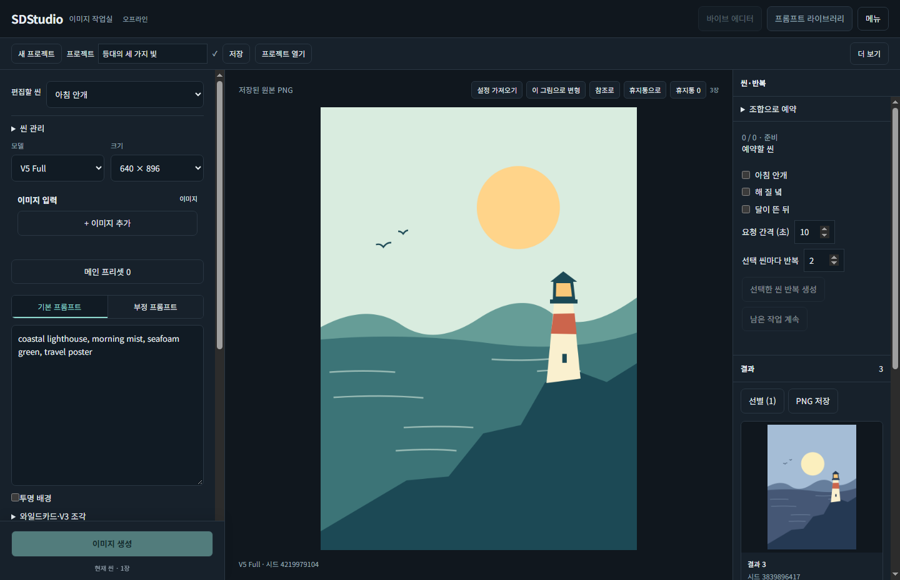

# SDStudio

NovelAI로 여러 씬을 반복 생성하고, 마음에 드는 컷을 선별해 PNG나 ZIP으로 저장하는 데스크톱 작업실입니다.

*Windows 작업실에서 촬영한 화면입니다. 등대 그림과 프로젝트는 화면 소개를 위해 만든 오프라인 예시입니다.*

## 첫 프로젝트

1. **메뉴 → API 토큰·연결 모드**에서 NovelAI 토큰을 설정합니다.
2. 씬에 프롬프트를 쓰고 모델과 해상도를 고릅니다. **이미지 추가**에서 변형할 원본이나 정밀 참조를 붙일 수 있습니다.
3. 한 컷은 **이미지 생성**, 여러 컷은 **조합으로 예약**을 사용합니다. 인물과 감정을 조합하고 반복 횟수와 참조 추가분을 확인합니다.
4. 오른쪽 결과 목록에서 **선별**을 켜고 남길 컷을 고릅니다. 선별이 비어 있는 씬만 다시 예약하거나 선택한 원본 PNG들을 ZIP으로 저장할 수 있습니다.

## 설치와 개발

Windows x64 설치 후보는 NSIS 형식입니다. 이 포크의 공개 배포 여부는 [릴리스 목록](https://github.com/HyunnJg/SDStudio/releases)에서 확인할 수 있습니다. 소스에서 실행하거나 설치본을 만들 때는 [개발 환경과 패키징 절차](docs/DEVELOPMENT.md)를 참고하세요.

프로젝트와 선별 결과, 프롬프트 라이브러리, 저장한 촬영 조합을 함께 보관하려면 [Windows 작업실 백업과 복원](docs/WORKSPACE_BACKUP.md)을 참고하세요.

[현재 상태](docs/STATUS.md) · [작업 계획](docs/ROADMAP.md) · [설계 결정](docs/DECISIONS.md) · [라이선스 조사](docs/LICENSE_REVIEW.md)

## 원작과 크레딧

Sunho Kim의 SDStudio를 기반으로 한 독립 포크입니다. 원작의 씬·선별·리터칭 작업 흐름과 Git 이력을 이어받았습니다. [원본 프로젝트 소개와 화면](https://github.com/sunho/SDStudio/tree/f2088add103ad683a31e0590448e6e5bb4d71556) · [원작자와 기여 출처](CREDITS.md) · [고지 확인 범위](docs/licenses/APP_LICENSE_STATUS.md)

원작자는 이미지 씬 기능의 출발점으로 [dendenai.xyz의 프리셋 기능](https://dendenai.xyz)을 명시했습니다.
