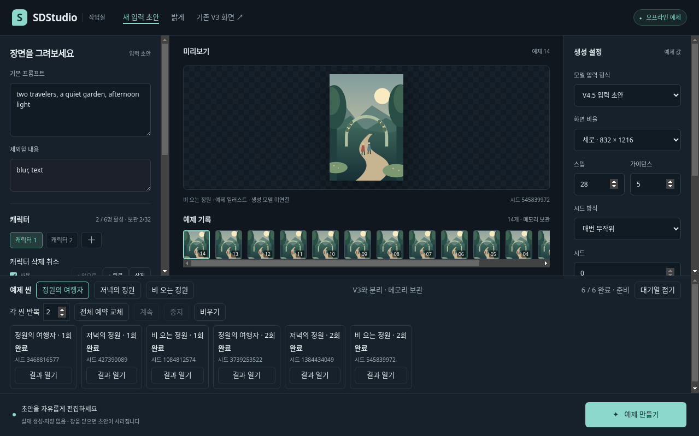
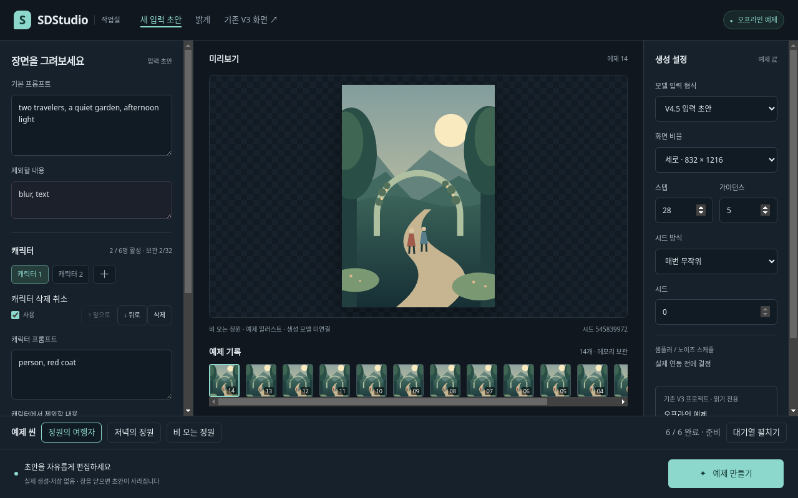

# PR #6 추가 검토 처리

기준: `1f8c868fe16213efa84ecae50ce26d27a580c2b5`, 사용자 제공 Gemini·Claude 의견. 처리일: 2026-11-21 (Asia/Seoul).

| 의견 | 소스 대조·처리 |
| --- | --- |
| 대기열이 미리보기 공간을 차지함 | 채택·수정. 기본/완료 상태는 한 줄 요약, 예약 시 펼침, 수동 접기·펼치기. 접어도 진행 요약과 실행 중 중지 버튼 유지 |
| 반복 우선 / V3 씬 우선 차이 | 확인. mock은 A·B·C→A·B·C, V3 runInternal은 맨 앞 작업의 total 횟수를 마친 뒤 dequeue. P1-02에서 선택·변경 고지를 결정 |
| V3는 예약 때 와일드카드를 한 번만 전개할 수 있음 | 해당 추정은 채택하지 않음. createSDPrompts는 PromptNode 구조를 만들고 SDImageGenHandler가 job.prompt에 보관. 실제 handleTask마다 lowerPromptNode를 호출하여 random 노드에서 Math.random 선택. 같은 random 노드에 통제 난수 0/0.99/0을 넣어 실제 함수가 red/blue/red를 반환함을 비과금으로 확인. 전체 V3 큐 실기 회귀는 P1-03에 남김 |
| 단일 실행과 대기열 경로 통합 | 채택·계획. 실제 연결 전에 현재 씬 1건도 공통 실행기로 보내는 구조를 검토. 이번 mock 경로는 변경하지 않음 |
| beforeRender 대기 중 stop 후 호출 | 현재 mock의 '선택된 현재 예제는 마침' 정책과 일치. 실제 연동에서는 전송 직전 중지 확인·pending 복구, 요청 제한시간/AbortSignal, 전송 여부 불명 시 자동 재시도 금지를 P0-03b 조건에 추가 |
| StrictMode cleanup | 현재 src/renderer에 StrictMode 진입점 없음 확인. 향후 도입 전 setup/cleanup 반복 수명 검증을 필수 조건으로 기록. 이번에 임의 활성화하지 않음 |
| 무작위 시드의 0 입력 혼동 | 현 코드는 이미 disabled={draft.seedMode === 'random'}. 새 실기 검사에서도 비활성 속성을 확인. 값 0은 고정 모드로 돌아갈 때 사용할 보관값임 |
| V3 첫 화면 진입이 파일 저장에 미치는 영향 | P1-03의 읽기 전용 열기/닫기 전후 합성 세션 파일 해시 검사로 추가 |
| 선택 씬만 예약 | P1-02 범위에 포함. mock 3씬 전체 예약은 현재 유지 |

## 검증

Linux x64 / Node 22.4.1 / Electron 26.6.10. 작업실·큐 14/14, 범위 엄격 타입검사·린트·렌더러 빌드 통과. 실제 Electron 17시나리오 통과(390px 포함), 관찰한 원격 요청/렌더러 오류 0건. 단일 인스턴스 잠금은 하네스에서만 대체하고 OS sandbox 유지. 합성 appData만 사용. Windows/macOS·개발 시작 명령 재검사·실제 API는 미실행.

1279×799에서 캔버스 높이 **228→390px**. 자동 접기와 수동 펼치기, 390px 예약·시작·중지까지 확인했다. [원본 보고서](../validation/2026-11-21-queue-collapse.json).

