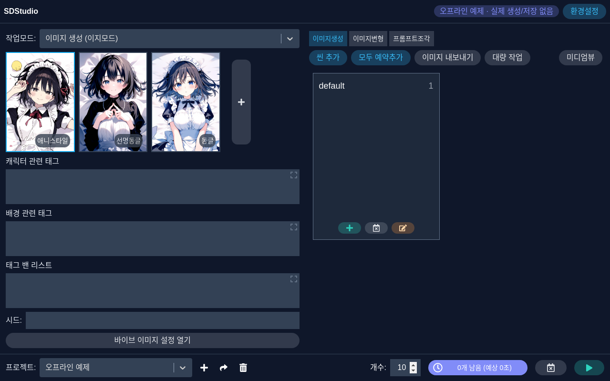

# P0-02 / P0-01c 오프라인 기동 검증

기준: PR #2 병합 `fecec7542bf20ff2901d4aa67c0b30805aaf6f13`.
브랜치: `work/p0-offline-preview`. Linux x64, Node 22.4.1, Electron 26.6.10.

## 구현

- 격리 프로필은 기본 오프라인이다. `SDSTUDIO_OFFLINE=0`으로 명시해야 온라인 모드를 선택한다. 가짜 백엔드는 이 값과 관계없이 오프라인이다.
- 시작 스크립트가 오프라인 기본값을 개발 서버와 자식 프로세스에 전달하고, 메인 프로세스가 preload에 필요한 두 플래그만 전달한다.
- Chromium HTTP/WebSocket은 loopback 개발 서버를 제외하고 차단한다. 계정·이미지 API는 토큰을 읽기 전에 거부하며 다운로드·로컬 AI·외부 페이지 IPC도 거부한다.
- 원본 IP 확인은 온라인 모바일 분기에만 남겼다. 데스크톱에서는 UUID 생성·저장과 IP 조회를 하지 않는다. 모바일 존치 여부와 타임아웃 개선은 별도 작업이다.
- 업데이트 서비스는 생성자에서 시작하지 않고, 기본 비활성 및 run 중복 시작 방지·stop을 제공한다. 조회·안내 대상은 포크다. 버전의 v 접두사도 처리한다.
- 비활성 로컬 AI는 파일 확인·삭제·다운로드·프로세스 시작 이전에 종료한다.
- 가짜 백엔드는 세션·이미지를 메모리에만 보관한다. PNG 픽스처를 반환하며 실제 생성·변형·계정·다운로드를 흉내 내 성공했다고 주장하지 않는다. 화면에 실제 생성/저장이 없는 예제라고 표시한다.
- 실제 기동에서 발견한 Google Fonts 요청을 제거했고, 기존 시스템 폰트 폴백을 사용한다. 미리보기 썸네일은 저장된 픽스처를 복사한다.
- 비패키징 프로덕션 번들의 preload 경로를 바로잡고 초기 데이터 준비를 기다린 뒤 창을 연다.

## 검증 결과

| 검사 | 결과 |
| --- | --- |
| 프로필·명령·진입 테스트 | 13건 통과 |
| Linux Electron 프로필 실기 테스트 | 2건 통과. 원본 파일 불변 및 없던 원본 폴더 미생성 |
| 오프라인 서비스·백엔드 테스트 | 9건 통과. 초기화·중복 시작·중지, 계정/API 선행 차단, 가짜 파일·생성 등 |
| 새/수정 독립 모듈의 엄격 타입검사·린트 | 통과. 전체 저장소 tsc의 기존 TS2688과 구분 |
| 메인·렌더러 빌드 | 통과 |
| 실제 Electron + 가짜 백엔드 전체 화면 | 통과. 예제 프로젝트 및 생성 대기열 1건 완료, PNG 픽스처 확인 |
| 실제 Electron + 파일 백엔드 오프라인 화면 | 통과. 다운로드·spawn·모델 로드·배경 제거·외부 페이지 IPC 5개 차단 |
| 두 기동 검사의 Chromium 원격 요청 / 렌더러 오류 | 각각 0건 / 0건. 테스트 중 예상한 loopback 통신은 허용 |
| 가짜 원본 appData | 두 기동 검사 후 비어 있음 |

보고서: [가짜 백엔드](2026-11-20-offline-mock.json), [파일 백엔드](2026-11-20-offline-real.json).



## 실행 환경의 제한

이 환경은 Electron의 단일 인스턴스 잠금에 필요한 Unix 소켓을 허용하지 않는다. 기동 검사는 **매번 새 프로필을 사용하고 테스트 하네스에서만 해당 잠금을 모의 처리**했다. 제품 코드의 잠금은 유지했다. 창·preload·React·서비스·대기열은 실제로 실행했다.

디스플레이 없는 Ozone 실행은 전체 창 생성에서 실패하여, 인증된 임시 Xorg dummy 디스플레이로 검사했다. DBus/udev 등 환경 경고는 있었으며 렌더러 오류와 구분한다. Windows/macOS, 실제 단일 인스턴스 잠금, 종료 시 저장 흐름, 실제 NovelAI 생성은 미검증이다. 테스트는 캡처 후 종료한다.

## 재현 명령

일반 X11 디스플레이가 있는 Linux에서:

```sh
npm run build
npm run test:profile
npm run test:profile:electron
npm run test:offline
npm run smoke:offline
npm run smoke:offline -- real
```

디스플레이 없는 일반 CI는 `xvfb-run -a npm run smoke:offline`처럼 디스플레이를 제공한다. `SDSTUDIO_SMOKE_SKIP_SINGLETON=1`은 위 환경 제한을 재현할 때만 테스트 하네스에서 사용한다. Electron 추가 인자는 `SDSTUDIO_TEST_ELECTRON_ARGS` JSON 배열로 명시하며 sandbox 해제는 기본값이 아니다.

브라우저용 미리보기는 `npm run start:mock`이다. 이 모드는 Electron을 자동 실행하지 않는다. 이번 전체 화면 검사는 Electron 경로이며, 독립 브라우저의 실기 검증은 아직 하지 않았다.

## 다음 단계

P0-03에서 공식 모델/API 규격과 저장 호환 범위를 결정한다. 이후 P1 화면 구성을 바꾸고 기존 데이터·종료 저장·메타데이터의 회귀 검증을 추가한다. 이번 예제 이미지는 생성 API의 성공 근거가 아니다.
