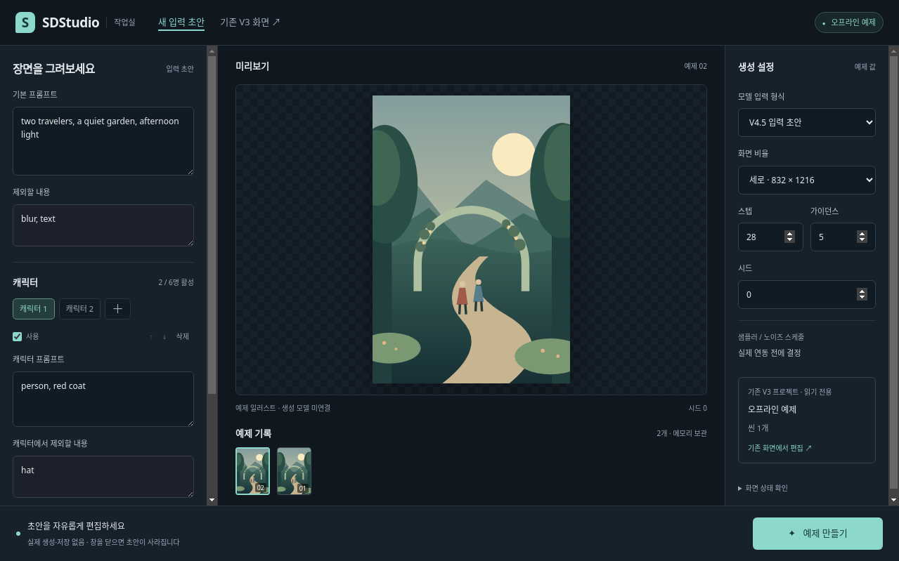
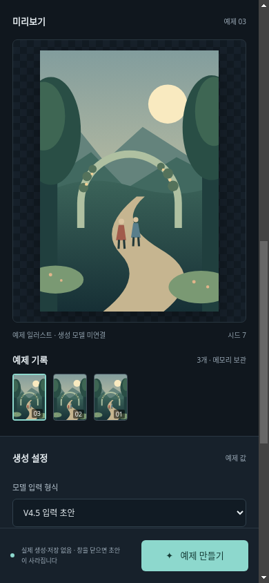

# P1-01 오프라인 작업 화면 검증

기준: `7a67b3960976e0ed996a91251c5986a8631c749e` (PR #4 추가 검토 보완·병합).
브랜치: `work/p1-offline-workspace`. 2026-11-20 (Asia/Seoul).

## 구현 범위

- mock 모드의 첫 화면을 새 작업실로 구성했다. 프롬프트·캐릭터 / 결과·예제 기록 / 설정의 세 영역과 하단 실행 버튼이다. 800px 이하에서는 세로 스크롤과 고정 실행 영역으로 바뀐다.
- 기본·부정 입력, 캐릭터 추가·순서·활성·삭제, 자동/격자 위치, 모델 입력 형식·비율·시드·스텝·가이던스를 편집한다. 위치는 행/열로 보관하고 예제 투영 때만 좌표로 계산한다.
- 모델·sampler·noise schedule의 실제 API ID를 기본값처럼 노출하지 않는다. 새 모델 선택은 입력 형식 선택이며 API 연동이나 실제 생성이 아니다.
- 예제 만들기는 mock 백엔드만 호출한다. 직접 작성한 정원 SVG를 메모리로 반환하며 결과 기록은 최근 6개를 보관한다. 실제 생성 비용·이미지 품질을 모사하지 않는다.
- 입력 길이·연결 오류는 명시적인 “화면 상태 확인”에서 합성 응답으로 검사한다. 입력과 이전 결과를 유지하며 길이 한도를 글자/추정 토큰 수로 표시하지 않는다.
- V3 프로젝트는 이름과 씬 개수만 읽기 전용 요약한다. 기존 화면에서 편집 버튼으로 기존 컴포넌트를 열고 돌아와도 메모리 초안/예제 기록이 유지된다. 새 화면에서 파일 드롭으로 V3 자료가 바뀌지 않게 했다.
- 비 mock 실행은 기존 화면을 유지한다. mock 창만 최소 크기를 360×600으로 낮췄다. 새 CSS는 작업실 아래에 한정했다.

## 실행한 검사

Linux x64 / Node 22.4.1 / Electron 26.6.10.

| 검사 | 결과 |
| --- | --- |
| `test:nai-contract` | PR #4 보완 후 10건 통과. 입력 정책·가짜 ID 포함 |
| `test:workspace` | 6건 통과. 독립 메모리 초안, 격자/프롬프트 대응, 빈 숫자, mock 무통신·파일 미기록, 오류 표시 |
| `test:offline` | 11건 통과 |
| `npm run build` | 메인·렌더러 성공 |
| 새 UI·독립 모듈 타입검사 및 린트 | 통과. 전체 저장소 TS2688 문제와 구분 |
| Electron 개발 시작 명령 | start:preview로 동일 8개 화면 시나리오 통과. 인터페이스 열람·잠금의 검사 환경 대체를 아래 명시 |
| 비 mock 파일 백엔드 기동 | 기존 V3 화면 유지, IPC 5종 차단, 원격 요청·렌더러 오류 0건 |
| 실제 Electron 새 화면 | 캐릭터 편집·격자 선택·예제 출력·오류 표시·기존 화면 왕복 확인 |
| V3 데이터 불변 | 새 초안 작업 전후 기존 Session.toJSON 결과 일치 |
| 좁은 창 | 390px에서 가로 넘침 없음, 시드 입력·실행 버튼 접근 및 결과 확인 |
| 원격 요청·렌더러 오류 | 관찰한 Chromium 원격 요청 0건, 오류 0건 |
| 합성 원본 appData | 기동 후 비어 있음 |

실제 입력 이벤트와 React 화면을 검사한다. 새 화면의 예제 실행은 기존 V3 대기열/API에 연결하지 않는다. 서버 오류 항목은 합성 오류이며 실제 서버 오류 수신 성공이라는 의미가 아니다.

보고서: [프로덕션 번들](2026-11-20-workspace-smoke.json), [개발 시작 명령](2026-11-20-workspace-dev-smoke.json), [파일 백엔드](2026-11-20-workspace-real-smoke.json).

## 화면

1280×800 데스크톱:



390px 창의 결과 영역(스크롤한 상태):



## 재현

```sh
npm ci
npm run build
npm run test:workspace
npm run test:nai-contract
# X11 DISPLAY가 있는 Linux
npm run smoke:workspace
# 브라우저에서 메모리 예제만 보기
npm run start:mock
# Electron 개발 모드 + 격리 프로필
npm run start:preview -- /절대/개발프로필
```

`start:preview`는 mock 백엔드와 격리 경로를 자식 프로세스에 전달한다. 개발 서버는 격리 경로 없는 mock 실행에서는 Electron을 띄우지 않고, 경로가 있으면 preload/main을 실행한다. 이 환경의 개발 명령 실기 결과는 아래 제한과 구분한다.

## 제한과 후속 작업

- 프로덕션 번들의 화면 검사는 인증된 Xorg dummy에서 실행했다. 환경의 Unix 소켓 제한으로 단일 인스턴스 잠금만 하네스에서 모의 처리했다. 제품 잠금과 OS sandbox는 유지한다.
- 개발 시작 명령 검사는 제한된 네트워크 인터페이스 열람 syscall을 Node 개발 도구에서 loopback 정보로 대체하고, Electron 단일 인스턴스 잠금을 하네스에서 대체했다. 제품 코드에는 이 대체를 넣지 않았다. 이 조건에서 start:preview → 개발 서버 → preload/main → 화면 검사 8개가 완료됐고 원본 appData는 비어 있었다. 앱을 종료한 뒤 개발 서버 프로세스를 정리했다.
- 개발 화면에서 발견한 기존 React 키 경고는 정적 워크플로 레이아웃의 누락된 key와 ProgressBar가 예약된 key prop을 읽는 코드 때문이었다. 두 곳을 작은 별도 커밋으로 고친 뒤 개발 화면의 렌더러 오류도 0건이었다.
- Windows/macOS, 패키징, 독립 브라우저 실기, 종료 저장·기존 이미지 편집은 미검증이다. 전체 저장소 타입검사의 기존 TS2688도 남아 있다.
- P1-02 실제 연결은 P0-03b의 모델 바인딩·메인 전송/오프라인 검증·인증·저장 복구 구현 이후다. 이번 변경은 토큰·계정·실제 API를 사용하지 않았다.
