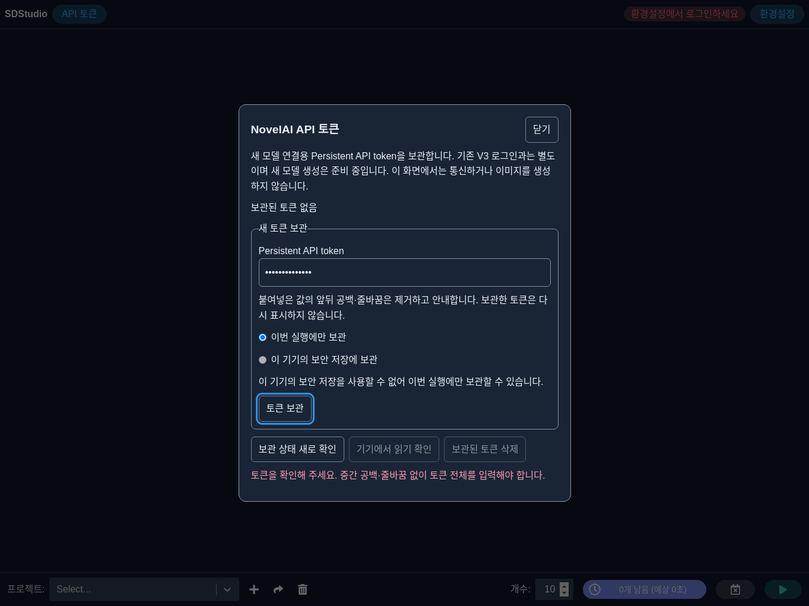

# 포크 식별·토큰 입력/복구 화면 — P0-03b2 일부

2026-11-21. 시작 기준 `0282db1`(PR #10 병합), 런타임 `e64d205ad06c5e82218f7957a62894c782effe44`.

PR #10의 저장소 일관성 보완과 MIME 공백 처리를 병합한 뒤 토큰 입력 화면을 연결했다. 포크 내부 식별은 **SDStudio-HyunnJg / io.github.hyunnjg.sdstudio**로 고정했다(D-026/027). 실제 모델 생성이나 프로젝트 저장을 완료한 PR이 아니다.

## 실행 결과

Linux x64, Node 22.4.1, Electron 26.6.10, Python 3.12.14. 실제 자격증명/인증·생성 API 호출/과금 없음. 새 의존성·lock 변경 없음.

| 검사 | 결과 |
| --- | --- |
| identity | 3/3: builder/runtime 이름·ID·실행 파일 대응, 기본 경로, 기존 토큰 파일 내용/mtime 불변, 명시적 개발 경로 보호, 링크 거부 |
| auth UI 입력·문구 | 3/3: 앞뒤 공백 정리, 내부 공백·개행/길이 거부, 보관/로컬 읽기와 서버 인증의 구분, 복구 오류 문구 |
| main auth/transport | 19/19: 이전 18건 + local check의 토큰 미반환/미보관/미지원 버전 |
| 기존 단위·합성 회귀 | offline 11, profile 13, startup 4, contract 10, workspace 14, bundle notices 3, license evidence 5 통과 |
| 기존 Electron | profile 2/2, 시작 실패 종료 1/1, main 인증/전송 1테스트/8체크 통과 |
| 범위 엄격 타입/린트 | appIdentity, forkProfile, naiAuth, authIpc, tokenInput, NaiAuthSettings 등 변경 모듈 통과. 전체 저장소의 기존 TS2688은 반복하지 않음 |
| 빌드·패키지 | production main/preload/renderer 및 Linux directory package 통과. 기존 Electron 네이티브 빌드를 재사용해 npmRebuild=false. publish=never, 서명/릴리스 없음 |
| 기본 프로필 실제 창 | 인증 UI 8체크 / 오프라인 UI 3체크. 임시 appData 안 원본 두 이름의 합성 파일 내용·mtime 불변 |
| 실제 패키지 인증 UI | 8체크. app.isPackaged=true, archiveUnchanged=true, 기본 userData가 임시 appData/SDStudio-HyunnJg이며 appData에는 그 폴더만 생김 |
| 실제 패키지 예제 화면 | 기존 17시나리오 + 새 화면의 오프라인 토큰 모달 3체크. 새/기존 화면 진입점 모두 확인 |
| 실제 패키지 고지 | 필수 자원 5개, 사본 250개, 번들 항목 143개, 복사 metadata 112개 검사. 원문 미확인 8건은 유지 |

두 패키지 검사 모두 원격 요청·렌더러 오류 **0건**. 전체 JSONL을 추가 커밋하지 않고 경로 검사/실행 보고서와 요약만 보관했다.

## 인증 UI 실기 범위

세션 보관, 입력의 앞뒤 공백 제거 안내와 성공 후 입력 비우기, 네트워크 없는 로컬 읽기, 삭제 취소/확인, 미래 버전 파일에 대한 read/세션 교체 거부와 원본 보존, 명시적 삭제 복구, 잘못된 입력, 390px 가로 넘침, 닫기/다시 열기 시 입력 제거, Escape 뒤 호출 버튼으로 포커스 복귀를 확인했다.

기본 프로필 검사는 SDSTUDIO_USER_DATA_DIR를 지우고 **생산 main의 bootstrap·실제 renderer/preload/IPC**를 사용했다. 온라인 플래그는 로컬 보관 IPC를 허용하기 위해 하네스에서만 선택하며, 세션에는 공유 오프라인 네트워크 훅을 설치한다. 생성/인증 엔드포인트를 호출하지 않는다. Linux 기본 암호화 공급자는 basic_text로 고정해 영구 선택 비활성 및 세션 동작을 확인했다. 정상 키링의 성공 저장 UI는 미실측이다.

실제 패키지 스모크는 기존처럼 루프백 inspector로 하네스를 진입 전 주입하고 단일 인스턴스 잠금만 모의한다. 실제 app.asar 바이트와 app.isPackaged는 바꾸지 않는다. Unix socket 제약 때문에 인증된 Xorg dummy의 루프백 TCP를 사용했다. sandbox 해제 인자는 추가하지 않았다. 강화된 릴리스 fuse/실제 잠금 검증과는 구분한다.

## 화면·보고서

화면의 암호 입력은 합성 데이터이며 실사용 토큰이 아니다.

- [전체 요약·해시](2026-11-21-auth-settings-summary.json)
- [기본 프로필 UI](2026-11-21-auth-settings-default-ui.json), [오프라인 UI](2026-11-21-auth-settings-offline-ui.json)
- [실제 패키지 인증 UI](2026-11-21-auth-settings-package-ui.json), [실제 패키지 작업실](2026-11-21-auth-settings-package-workspace.json)
- [실제 패키지 고지](2026-11-21-auth-settings-notices.json)

## 남은 범위

Windows/macOS, 실제 키링·서명 변경의 복호화 연속성과 file URL 대소문자 실측은 미완료다. 초기 개발 프로필/원본 토큰 자동 이관도 하지 않는다. 현재 기본 프로필은 격리 규칙을 사용해 config.saveLocation을 무시한다. 프로필 이동·기존 데이터 가져오기는 후속 설계다.

공식 doc.json과 공식 모델 문서를 다시 확인했지만 모델별 API ID enum/필수값을 확정할 근거가 부족해 기존 fixture 모델 상수를 유지했다. [모델 근거·범위](../NOVELAI_API.md). 모델 바인딩·ZIP 해제 한도·새 프로젝트 저장/복구·대기열 연결은 다음 작업이며 P0-03b2 전체 완료로 표시하지 않는다. 실호출은 사용 계정·요청 수·Anlas 상한·중지 조건을 정한 별도 요청 범위에서만 진행한다.
