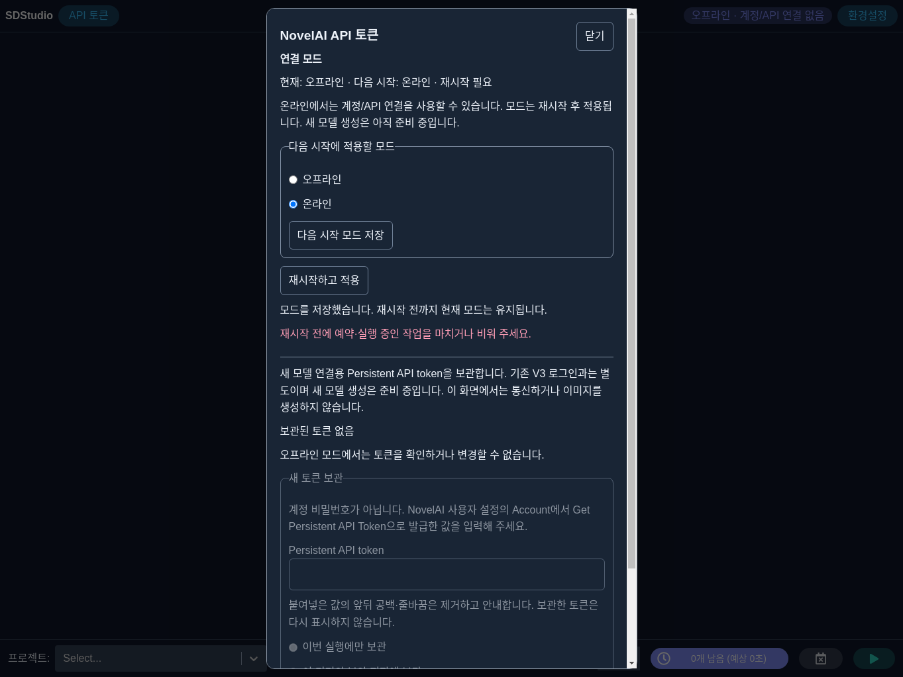

# 앱 내 연결 모드와 실제 재시작 — P0-03b2 일부

2026-11-21 (Asia/Seoul). 시작 기준 `0f261e8`(PR #11 보완·병합), 구현 커밋 `c116fe3fffe50dae8e70433e031fd0cabd81625f`, 트리 `368641eced79680180ff049f3a7df6a9c41f7b63`.

기본 오프라인을 유지하면서 **일반 포크의 API 토큰 창에서 다음 시작 모드를 저장하고 실제 재시작**할 수 있게 했다. 모델 바인딩/실제 생성·새 프로젝트 저장은 아직 대기다. 명시적 개발 프로필·mock·환경변수 지정은 UI보다 우선한다. D-028 및 [PR #11 의견 처리](../reviews/2026-11-21-pr11-followup.md)를 참고한다.

## 검사 결과

Linux x64, Node 22.4.1, Electron 26.6.10, Python 3.12.14, builder 24.13.3. 기존 의존성/네이티브 빌드를 재사용했다. 새 npm ci 재현은 하지 않았다. 게시 전 동일한 소스 트리로 빌드했으며 문서 수정이 있는 작업 트리였음을 [요약](2026-11-21-network-mode-summary.json)에 기록했다.

| 검사 | 결과 |
| --- | --- |
| network-mode 단위 | 9/9. 최초/저장/재시작, 강제값 우선순위, 손상·미지원·초과 크기 보존, 설정만 초기화, 원자 교체 실패, IPC 발신자, 중복 재시작, 저장 전후 작업 확인 |
| 기존 단위·합성 | identity 3, auth UI 3, main auth/transport 19, offline 11, profile 13, startup 4, workspace 14, contract 10, bundle notices 3, license evidence 5 통과 |
| 실제 Electron | profile 2/2, 시작 실패 종료 1/1, main 인증/전송 1테스트·8체크 통과. X11 없이 두 검사가 skip됨을 확인한 뒤 Xorg를 제공해 실제 실행 |
| 범위 타입/린트 | shared/main networkMode, restartPreparation, NetworkModeSettings, NaiAuthSettings 엄격 검사 통과. 전체 저장소의 기존 TS2688은 이번 범위 검사와 구분 |
| production 빌드 | main/preload/renderer 및 고지 생성 성공. 전체 tsc와 달리 기존 webpack transpileOnly 사용 |
| Linux 실제 패키지 | --dir --publish never, npmRebuild=false, 설치된 Electron/native 재사용. 서명·릴리스 없음 |
| 실제 native 재시작 | 서로 다른 PID 3개, native relaunch 2회. [보고서](2026-11-21-network-mode-native.json) |
| 패키지 회귀 | 예제 화면 17시나리오 + 오프라인 토큰 창 3체크, 온라인 토큰 창 8체크. 390px 가로 넘침 없음. [보고서](2026-11-21-network-mode-regression.json) |
| 패키지 고지 | 실제 경로·사본/번들 해시 검사 성공. 원문 미해결 8건은 그대로이며 엄격 전수 고지 완료를 주장하지 않음. [결과](2026-11-21-network-mode-notices.json) |

## 환경변수 없는 실제 재시작 시나리오

1. 임시 appData에서 일반 패키지를 실행한다. SDSTUDIO_OFFLINE/MOCK_BACKEND/USER_DATA_DIR/PROFILE_CHECK는 제거한다. 최초 오프라인이며 모드 선택이 가능하다.
2. 더 새로운 설정 파일을 넣고 자동 삭제되지 않음과 확인을 거친 설정만 초기화를 검사한다. 온라인을 저장해도 현재 토큰 입력·IPC/원격 차단이 풀리지 않는다.
3. 재시작 취소는 현재 프로세스를 유지한다. V3 saveAll 실패 시 native relaunch가 호출되지 않는다. 중지·비운 V3 큐라도 진행 promise가 남아 있으면 차단하고 완료 뒤 허용한다.
4. 합성 V3 씬 meta의 변경을 실제 saveAll로 저장한 뒤 첫 native relaunch한다. 관찰 wrapper가 디스크의 변경을 확인한 뒤 실제 Electron relaunch에 위임한다.
5. 새 PID가 저장된 온라인을 읽는다. mode 환경변수 없이 토큰 입력/세션 한정 보관·로컬 읽기가 가능하다. 합성 토큰만 사용하고 인증·생성 요청은 하지 않는다.
6. 오프라인을 저장하고 두 번째 native 재시작한다. 새 PID에서 auth 및 위험 IPC 5종 거부가 복원된다. V3 fixture는 보존된다.

모든 단계에서 원격 요청·렌더러 오류 0건, app.asar SHA-256 불변, 합성 원본 두 프로필의 파일 내용·mtime 불변이다. 저장된 시작 모드를 바꾸는 기능은 승인된 로컬 설정 IPC에 한정되며 토큰 IPC의 오프라인 거부 정책을 변경하지 않는다.



스크린샷은 미완료 작업 차단 안내가 나온 상태다. 회귀 검사에서 오프라인 창 재진입 때 포커스가 바깥에 남는 문제를 발견해 dialog 자체에 초기 포커스를 두었다. 수정 후 창 재진입·Escape 복귀와 좁은 창 검사를 다시 통과했다.

## 재현과 한계

```sh
npm run test:network-mode
npm run build
npx electron-builder --linux --dir --publish never --config.npmRebuild=false --config.electronDist=node_modules/electron/dist --config.directories.output=/tmp/sdstudio-network-mode-package
npm run smoke:network-mode -- /tmp/sdstudio-network-mode-package/linux-unpacked
```

창 검사는 X11 DISPLAY가 필요하다. 이 환경에서는 Xorg dummy/TCP 디스플레이를 제공했다. Unix 소켓 제한으로 단일 인스턴스 잠금만 하네스에서 모의 처리한다. 테스트는 loopback inspector로 외부 하네스를 주입하고, native relaunch에 검사 인자만 전달하며 실제 재시작을 모의하지 않는다. 프로덕션 app.asar와 app.isPackaged는 변경하지 않는다. 온라인 단계도 공유 오프라인 훅을 검사 하네스에서 추가 적용하므로 실제 외부 서비스에 접속하지 않는다.

실제 계정/키링 성공·NovelAI 서버 인증/생성/과금·Windows/macOS·설치 프로그램·서명/공개 배포는 미실행이다. basic_text 영구 저장 거부와 세션 보관은 검증했다. 일반 창 닫기의 기존 저장 흐름을 전면 수리한 작업이 아니며, 이번 제어된 재시작은 별도 저장 완료 후 close 경로를 사용한다. 임시 초안/예제 결과·세션 토큰의 재시작 소실은 확인창에 표시한다. 릴리스 fuse 강화와 inspector 검사 방식은 P3에서 함께 다룬다.

다음 범위는 P0-03b2의 모델별 근거/바인딩·제한된 ZIP 해제·새 프로젝트 저장/복구다. 실제 호출은 계정·요청 수·Anlas 상한·중지 조건이 정해진 별도 범위에서만 수행한다.
