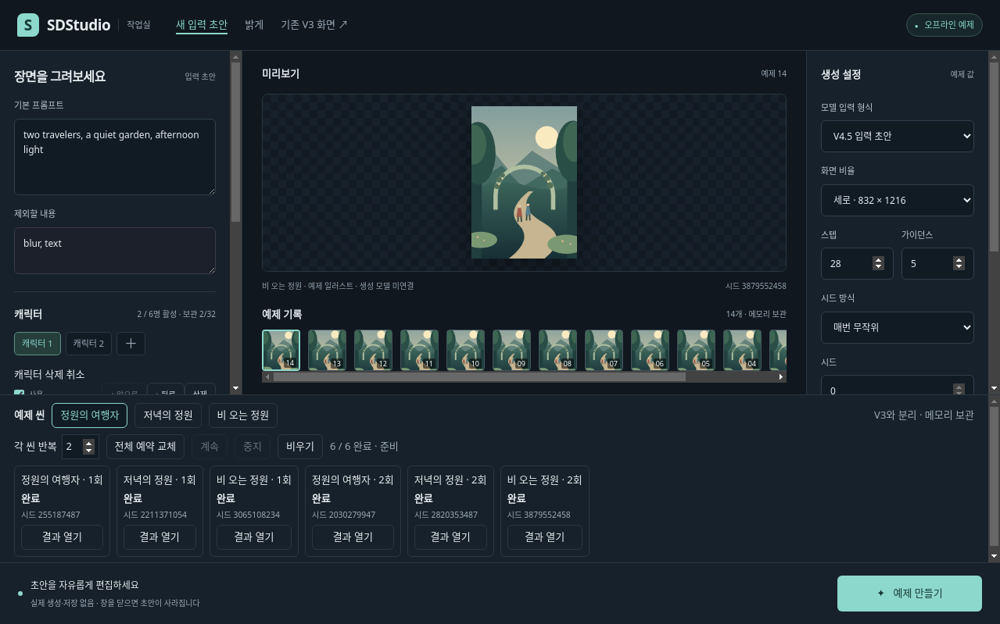
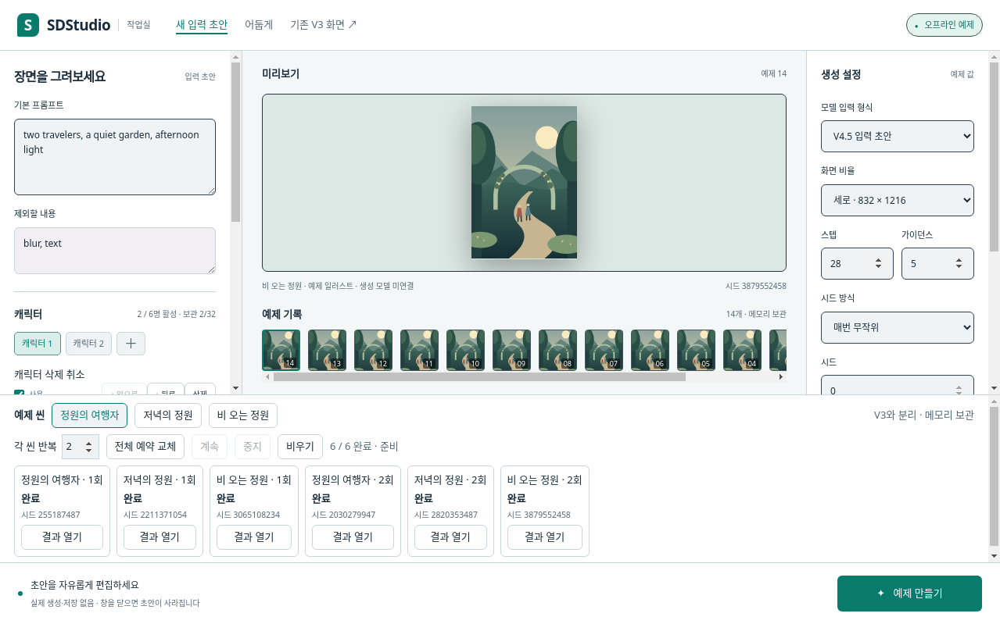
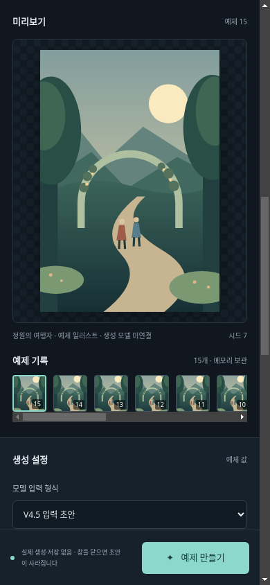
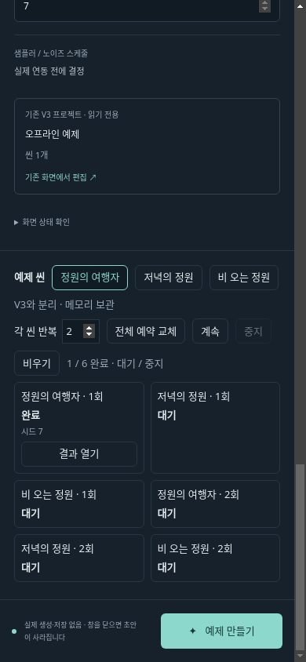

# P1-01b 예제 씬·대기열 검증

날짜: 2026-11-21 (Asia/Seoul). 브랜치: `work/p1-scene-queue`.
구현 커밋: `306840280e8ebeeb4f14f5d33310838e1f71cc18`.
기준: PR #5 보완·병합 `4b16e4e299c5edeffce0a51ef319396e26905b74`.

## 구현과 정책

- 새 화면 하단에 독립 메모리 씬 3개와 대기열을 추가했다. 각 씬의 입력을 따로 편집하고 기본 반복 2회로 6건을 예약한다. 예약 이후 편집은 예약 당시의 스냅샷을 바꾸지 않는다.
- 실행은 직렬이다. 중지는 **현재 예제 완료 후 다음 작업을 시작하지 않는** 동작이며, 계속은 남은 대기 작업만 실행한다. 실패는 자동 중지·전역 안내로 표시하고 자동 재시도하지 않는다. 현재 예제의 실제 전송 취소를 구현했다는 의미가 아니다.
- 무작위/고정 시드를 선택한다. 무작위는 실행 직전에 결정하고 같은 예약의 충돌을 피한다. 고정 0은 유지하며 결과/요청/대기열에 실제 사용한 시드를 보관한다.
- 큐와 결과는 App이 소유하므로 기존 V3 화면을 보아도 진행·결과가 유지된다. 결과 열기로 해당 씬 이름·시드·예제 이미지를 확인한다. 예약 60건, 최근 결과 120개가 상한이며 화면은 3씬 × 반복 1~10회를 제공한다.
- 작업실을 프롬프트/캐릭터·결과/기록·설정·씬/큐 패널로 나눴다. 전역 알림/대화상자는 두 화면에 공통이다. 기존 밝게/어둡게 설정을 따르고 캐릭터 활성 한도 초과를 즉시 알린다. 비활성 포함 보관 슬롯은 32개, 마지막 삭제 1건은 현재 씬에서 취소할 수 있다.
- V3 Session/프리셋/실제 대기열·와일드카드·저장 형식에는 연결하지 않았다. 모델별 API ID/샘플러/노이즈 스케줄은 fixture 자리표시값을 유지한다. 결과는 직접 작성한 SVG이며 실제 생성·과금은 없다.

## 실행 결과

Linux x64 / Node 22.4.1 / Electron 26.6.10.

| 검사 | 결과 |
| --- | --- |
| `npm run test:workspace` | 14/14. 씬 선택/스냅샷, 3씬×2회, 무작위 시드 기록, 고정 0, 실행 중 중지·계속·중복 시작 방지, 실패 후 중지·이전 결과 유지, 잘못된 예약의 원자성, dispose 뒤 늦은 결과 방지 포함 |
| `npm run test:nai-contract` | 10/10 |
| `npm run test:offline` | 11/11 |
| `npm run build:renderer` | 성공. 메인은 수정하지 않았으며 이전 빌드 사용 |
| 새 패널/초안/큐의 엄격 타입검사·린트 | 통과. 전체 저장소 타입검사의 기존 TS2688과 구분 |
| 프로덕션 Electron | 16개 UI 시나리오 통과, 1279×799 및 390×844 |
| 실제 `start:preview` 개발 시작 명령 | 같은 16개 UI 시나리오 통과 |
| 비 mock 파일 백엔드 | 기존 화면 유지·위험 IPC 5종 거부 |
| 관찰한 원격 요청 / 렌더러 오류 | 세 실행 모두 0 / 0 |
| 합성 원본 appData | 실행 후 비어 있음. 사용자 원본 폴더는 사용하지 않음 |

16개 시나리오는 전역 서비스 대화상자, 모델 형식, 캐릭터/격자, 고정 0 출력, 길이·연결 오류, V3 데이터 비교, 화면 왕복, 테마, 삭제 취소, 6건 예약·중지, V3 화면을 거친 계속·기록 시드·결과 열기, 즉시 한도 경고/활성 수 기준 추가, 대기열 오류의 전역 알림, 좁은 창 실행, 좁은 창 예약·시작·중지를 검사한다.

V3 불변 비교는 두 단계다. 새 초안 편집 전후 Session.toJSON이 같음을 확인하고, **기존 V3 화면이 자체 초기화한 뒤**의 스냅샷과 큐 실행 후를 비교한다. 기존 화면 첫 진입은 selectedWorkflow/presetShareds를 초기화하므로 최초 기동부터 모든 화면 전환이 무변경이라고 주장하지 않는다.

원본 JSON: [프로덕션](2026-11-21-scene-queue-prod.json), [개발 명령](2026-11-21-scene-queue-dev.json), [파일 백엔드](2026-11-21-scene-queue-real.json).

## 화면









## 재현과 제한

```sh
npm run test:workspace
npm run test:nai-contract
npm run test:offline
npm run build:renderer
# X11 DISPLAY가 있는 Linux
npm run smoke:workspace
# Electron 개발 실행
npm run start:preview -- /절대/개발프로필
```

화면 캡처 환경변수는 `SDSTUDIO_SMOKE_SCREENSHOT`, `SDSTUDIO_SMOKE_NARROW_SCREENSHOT`, `SDSTUDIO_SMOKE_QUEUE_SCREENSHOT`, `SDSTUDIO_SMOKE_LIGHT_SCREENSHOT`이다.

- 이 환경에서는 인증된 Xorg dummy를 사용하고, 단일 인스턴스 잠금만 하네스에서 대체했다. OS sandbox는 유지했다. 개발 도구의 네트워크 인터페이스 열람 syscall은 loopback 정보로 대체했다. 제품 코드에는 환경 대체를 추가하지 않았다.
- Windows/macOS, 실제 단일 인스턴스 잠금, 독립 브라우저 실기, 패키징, 실제 API/계정·토큰 보관·과금, 종료 저장은 미검증이다. 새 씬/큐는 창을 닫으면 사라진다.
- 큐 결과는 같은 예제 SVG로 표시한다. 기록한 요청이 실제 서버에서 수용되는지 또는 생성 품질을 검사하지 않는다. 모델별 실제 좌표 규칙·전송/인증·저장 호환은 P0-03b, 기존 씬×프리셋×와일드카드 연결은 P1-02에 남는다.
