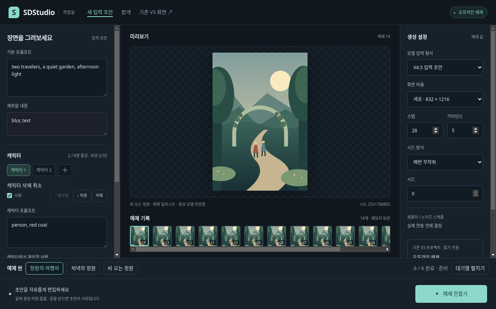

# P0-04b1 실제 Linux 패키지 범위·제외 검증

2026-11-21 / 기준: PR #7 보완·병합 `45a1ab3c07ecdcbf231627641a68a763936695e4`.
브랜치: `work/p0-package-manifest`. 구현·최종 조사 소스: `6e2b76b60bcfb50b8660d7b2a9ea9d0e1f8e411e`.

## 확인한 것과 변경

실제 electron-builder 디렉터리 패키지에서 ASAR 내부와 외부 리소스를 모두 읽었다. 단순 설정 예측과 구분한다.

| 실제 경로 | 변경 전 | 변경 후 |
| --- | --- | --- |
| resources/assets/fonts/NotoSans-*.ttf + OFL.txt | 포함 | 데스크톱 extraResources 필터로 제외 |
| resources/assets/db.txt | desktop data/db.csv와 같은 DB 중복 | 제외. Android의 원본 import는 유지 |
| resources/assets/assets.d.ts | 포함 | 런타임 불필요 선언 파일 제외 |
| app.asar: node_modules/sdsnative/db.csv·test.js 및 unpacked 사본 | 실제 포함 | 데스크톱 files 필터로 제외. 저장소의 원본·native 개발 테스트는 유지 |
| app.asar: data/db.csv | 포함 | 원본과 동일 SHA-256 유지 |
| sdnative.node / sharp-linux-x64.node | unpacked | 위치·내용·unpacked 상태 유지 |
| 살아남은 ASAR 파일 전부 | 기존 번들·의존성 | 모두 바이트 해시 동일 |

폰트는 @font-face나 TTF 경로 참조가 없고 CSS는 Noto Sans KR 이름을 찾는다. 화면 전후 비교에서도 레이아웃·기능 변화가 관찰되지 않았다. 원본 TTF/OFL을 저장소에서 삭제하거나 Android의 DB 사용처를 바꾸지 않았다.

**정정:** src/native/db.csv가 native/test.js에서만 읽힌다는 정적 사실과, 배포본에 들어가지 않는다는 주장은 다르다. 실제로 file: sdsnative 의존성을 통해 ASAR/unpacked 양쪽에 포함되어 있었다. 제외 전 manifest를 근거로 고쳤다.

## 측정 결과

- 물리 일반 파일: **1,241 → 1,233개**. ASAR 논리 파일: **1,930 → 1,928개**.
- 물리 일반 파일 바이트 합계는 **8,750,507바이트(약 8.35 MiB)** 줄었다.
- 물리 파일 바이트 합계는 [비교 JSON](2026-11-21-package-comparison.json)의 regularFileBytes/Saved를 따른다. ASAR 논리 항목은 용량 합계에 더하지 않는다. unpacked 파일은 논리/물리 뷰에 각각 나타나므로 항목 수를 합쳐 실제 파일 수라고 하지 않는다.
- 추가 파일 0개. 살아남은 일반 파일 중 변경은 ASAR 컨테이너 하나뿐이며, 그 내부에서 제외한 native 테스트 2파일 외 나머지 논리 파일은 동일하다.
- 역슬래시를 쓴 기존 generic asarUnpack 패턴은 이번에 바꾸지 않았다. 현재 포함된 네이티브 .node 2개는 실제 unpacked임을 확인했다. 이 결과가 모든 OS·모든 미래 네이티브 모듈의 패턴 유효성을 보장하지는 않는다.

전체 SHA-256/크기/포함 위치는 [변경 전 JSONL](2026-11-21-package-before.jsonl), [변경 후 JSONL](2026-11-21-package-after.jsonl)에 있다. 첫 줄은 검사 도구 해시·조사 커밋/dirty 및 개수, 이후 줄은 물리 파일 또는 ASAR 논리 파일이다. gitHeadAtInspection은 **검사 시점**이며 최초 패키지 빌드 커밋이라고 주장하지 않는다. 두 manifest는 깨끗한 구현 커밋에서 마지막으로 읽었다. baseline의 build 설정은 PR #7 병합본, after는 이 PR의 필터를 적용했다. main/renderer 소스·배포 package.json은 바꾸지 않았다.

## 실행한 검증

Linux x64 / Node 22.4.1 / Electron 26.6.10 / electron-builder 24.13.3.

| 검사 | 결과 |
| --- | --- |
| 전후 Linux --dir 패키징 | 성공. publish=never, 로컬 Electron 사용, npmRebuild=false |
| 실제 패키지 실행 파일 | 양쪽 app.isPackaged=true, 실제 resources/app.asar 경로 확인 |
| mock 화면 시나리오 | 양쪽 각각 17개 통과, 1279×799 / 390×844 |
| 제외 후 파일 백엔드 | 기존 화면·위험 IPC 5종 차단 확인 |
| 원격 요청 / 렌더러 오류 | 세 실행 모두 0 / 0 |
| 프로필·산출물 불변 | 합성 원본 appData 비어 있음. ASAR 검사 전후 해시 동일. 전체 manifest 항목도 기동 전후 동일 |
| 수집기 회귀 | 5/5. 새 소스의 깨끗한 커밋에서 두 임시 폴더로 재생성한 9출력 동일 |
| CLI | Node 문법 검사, 실제 manifest/packaged smoke 실행. 새 앱 소스·번들 빌드는 요구하지 않음 |

보고서: [전](2026-11-21-packaged-before-smoke.json), [후](2026-11-21-packaged-after-smoke.json), [파일 백엔드](2026-11-21-packaged-real-smoke.json).

인증된 Xorg dummy를 사용했다. 환경의 단일 인스턴스 잠금 제한 때문에 **검사 명령에서만** loopback 임시 포트의 Node inspector로 기존 smoke harness를 진입 전에 주입했다. 잠금만 모의 처리하고 곧 debugger를 닫았다. 패키지 파일·app.isPackaged·제품 시작 코드는 바꾸지 않았으며 OS sandbox도 유지했다. 일반 실행에 이 주입을 넣지 않았다.

## 화면

제외 전:



제외 후:


같은 레이아웃과 시스템 폰트 폴백을 사용한다. 기록의 무작위 시드 숫자는 실행마다 다르며 픽셀 전체가 같다는 검사는 아니다.

## 재현

의존성·네이티브·Electron과 번들이 준비된 환경에서, 비어 있는 외부 출력 폴더를 사용한다.

```sh
# 번들이 없거나 소스가 바뀌었다면 먼저 npm run build
npx --no-install electron-builder --linux --dir --publish never \
  --config.directories.output=/tmp/sdstudio-package-review \
  --config.npmRebuild=false --config.electronDist=node_modules/electron/dist
npm run package:manifest -- /tmp/sdstudio-package-review/linux-unpacked /tmp/package-manifest.jsonl
# Linux X11 DISPLAY 필요; 실제 패키지 바이너리 + 격리 오프라인 mock
npm run smoke:package -- /tmp/sdstudio-package-review/linux-unpacked
# 격리 오프라인 파일 백엔드
npm run smoke:package -- /tmp/sdstudio-package-review/linux-unpacked real
```

manifest 명령은 기존 산출물을 읽기만 한다. 앱을 빌드/실행/업로드하지 않는다. 출력은 패키지 안이나 소스 폴더에 둘 수 없으며 docs/validation 또는 외부 기존 폴더를 사용한다.

## 남은 범위

이번 작업은 P0-04b 전체 완료가 아니다. 실제로 남은 DB·그림체/아이콘·의존성/바이너리의 출처·재배포 조건, 원본 고지와 LGPL·ExifTool 조건 이행은 계속 확인해야 한다. DB 출처가 해결되지 않을 때를 위한 빈 DB 기동·자동완성 비활성 경로도 남는다.

첫 배포 OS는 확정하지 않았다. Linux 검증을 Windows/macOS 지원으로 확대하지 않는다. Windows exe·macOS 구성, AppImage/설치 프로그램·서명, 실제 singleton 잠금, 실제 API·과금·업데이트 배포는 미검증/미실행이다. 이 검사에서 원본 owner로 업로드하거나 공개 릴리스를 만들지 않았다.
