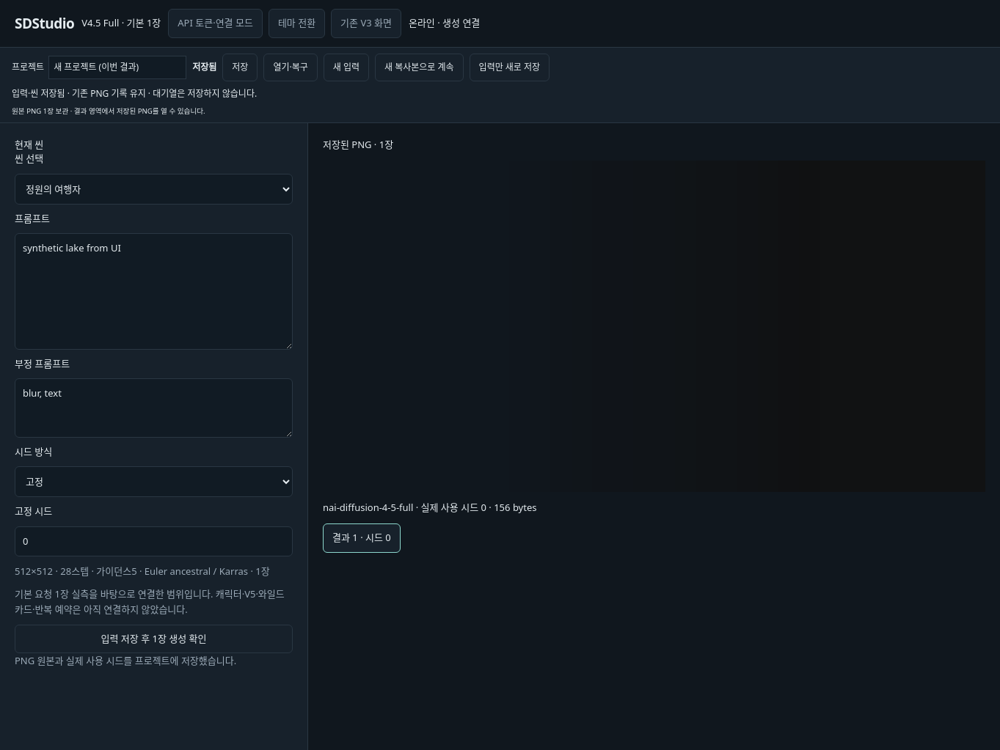
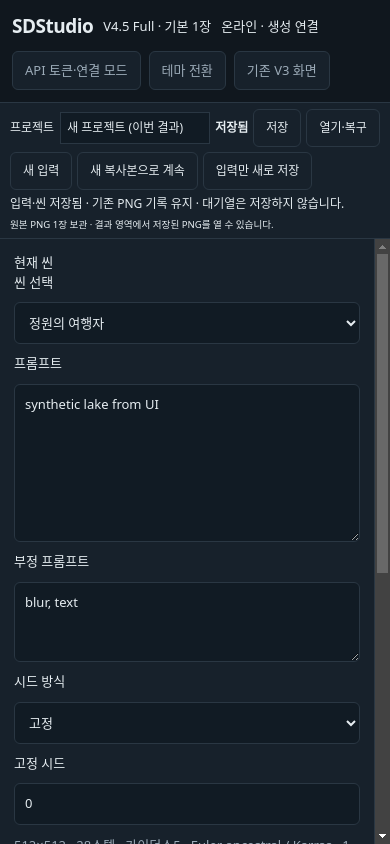

# 기본1장 생성·PNG 보관/표시 검증 — 2026-11-22

- 최종 정리/게시일: 2026-11-23 (Asia/Seoul).
- 기준: PR20 병합 `6445b0968d5847fe3b6e2fa4dbbfd97f263376a0`.
- 검토 안내 보완 `5e36a3d9718941b2d29de78d768b6e85611f60e9`, 생성 연결 `a602d755d4b67dec4e1fa4c2b4486f715b166f47`, 메인 종료 보호 `54f68804591a78cda3db30d9adfab811a1ccbf26`.
- 검증한 runtime 내용 tree `26fb258f08f4730b44f88878c29d0446383ba8ca`. 빌드는 동일 내용을 가진 작업 트리에서 수행했으며 pristine checkout/새 npm ci 검증이 아니다.
- [정제 보고서](2026-11-22-workspace-generation.json), [사용/실패/버전 경계](../WORKSPACE_GENERATION.md), D-041.

## 결과

| 검사 | 결과 | 확인 범위 |
| --- | --- | --- |
| generation | 16/16 | 연구 후보와 기본 body 일치·seed0/무작위·미지원 입력·오프라인·리비전/확인 선점·취소/단일 실행·저장 실패/이미 반영된 결과 중복 방지·잠금/한도·worker PNG·진단·v1/v2 이력/복사 |
| project/core UI/service close | 30/30 | store13, controller7, service/close10. 실제 저장 baseline·생성 뒤 입력 유지·복구 copy·finish=false 안내·메인 잔류 결과 guard |
| NAI main/response | 55/55 | main36, response19. 기존 인증/수신·기한/취소·엄격 ZIP/PNG 회귀 |
| offline/workspace/contract/network mode | 45/45 | 각각11/14/10/10. 계정 접근/오프라인·mock 큐·투영·연결 모드 회귀 |
| 단위 합계 | **146/146, skip0** | API 요청 없음 |
| 범위 엄격 타입/린트·포맷·구문 | 통과 | 새 shared/main service/worker/IPC/preload/connected UI/controller/close. 기존 App/main/TobBar 전체 린트·전체 저장소 tsc 통과 주장 아님 |
| main/preload/worker·renderer 빌드 | 통과 | 마지막 메인 종료 guard도 재빌드. 고지244개/원문 누락8건 유지 |
| 새 UI 실제 Electron | **3PID·8체크** | 생성·취소·남은 잠금 보존/새 프로젝트 저장, 다음 PID 열기, 오프라인 PNG 표시/생성 거부 |
| 실제 Linux ASAR 패키지 | **6체크+native quit** | app.isPackaged=true, archive 불변, worker가 ASAR 안에서 PNG add/read. 루프백3요청(정상2·취소1), 계정 호출0 |
| 기존 프로젝트 UI | 2PID·7체크 | 저장·전환/닫기 취소·잠금 복사·이력 복구·재개 회귀 |
| 기존 mock 작업실 | 17시나리오 | 씬3×2/중지/계속·결과·오류·V3 왕복·테마·좁은 폭 |
| Electron 프로젝트 bridge | 1테스트·6체크 | compiled sandbox preload/core IPC의 신뢰 프레임·프로필/이미지 복구·원본 불변 |
| 실제 패키지 고지 | 통과 | 250사본, bundle143, runtime112. 누락8건과 재배포 검토는 미완료 |

모든 최종 전체 UI 실행에서 외부 요청·renderer console 오류0, 원본 appData 빈 상태 유지. **실제 NovelAI 계정 요청0**이다. 토큰은 합성 세션 문자열이며, 그림은 합성2×1 RGBA PNG(투명 픽셀·불투명 metadata 청크)다. 새 UI의 화질이나 실제 계정 과금/할당량을 측정한 것이 아니다. 이전 사용자 기본1장 실측의 범위를 확대하지 않는다.

## 실제 경로와 테스트 대체 지점

production main/preload/React·defaultSession Electron net.request·ZIP/PNG 해석·ProjectService worker·파일 저장/읽기는 실제 코드다. 테스트 진입부에서만 정확한 IMAGE_ENDPOINT POST를 루프백으로 바꾼다. 별도 request guard도 비루프백 원격 요청을 차단한다. 운영 코드에는 목적지 override IPC/환경변수를 추가하지 않았다. 새 generation IPC7개는 단위에서 모두 발신자 검사 선행을 확인했고 신뢰 프레임 판정은 기존 인증과 같은 함수를 재사용한다.

패키지 스모크는 loopback inspector로 하네스만 진입 전에 주입한다. app.asar/app.isPackaged를 바꾸지 않았고 실행 전후 archive SHA가 같다. 기존 native 의존성을 재사용(npmRebuild=false)했으며 ASAR 전체 manifest는 커밋하지 않고 worker/archive 요약만 기록한다. 실제 단일 인스턴스 잠금은 환경 제한 때문에 모의했다. 390px은 **테스트에서만 최소 창 크기를 낮춘 레이아웃 검사**이며 일반 V3 창의1024px 최소 폭 정책을 바꾸지 않았다.

첫 정상 요청에서 서버가 받은 body SHA-256과 v2 기록의 binding.requestHash가 같음을 검사했다. PNG 바이트·metadata/alpha, 입력·시드0와 binding은 copy/open/recover를 거쳐 보존된다. 직전 v1 이력을 새 프로젝트로 복구해도 현재 v2 원본은 그대로다. 실제 이전 앱 실행/다운그레이드 설치는 하지 않았으며 이전 reader의 version1 거부 코드와 새 reader의 v1/v2 검사를 구분한다.

요청2는 응답 대기 중 취소해 서버 처리 불확실성 표시·추가 전송 없음·기존 결과 보존을 확인한다. 요청3은 전송 후 테스트가 남긴 write.lock으로 PNG 저장을 막는다. 제품이 잠금을 지우지 않는 상태에서 UI로 **입력·이번 결과만 새 프로젝트 저장**을 눌러 원본 잠금/기존 PNG를 보존하고 받은 결과를 추가 호출 없이 보관한다. 별도 단위에서는 같은 프로젝트의 저장-only retry 및 rename 후 이미 반영된 결과의 UUID 중복 방지를 검사한다.

## 재현과 관찰

Node22.4.1/Electron26.6.10(Node18.16.1), Linux x64, cookie 인증 TCP loopback Xorg dummy. 환경 npm11.19.1은 Node22.4.1 미지원 경고를 내므로 권장 설치 조합이 아니다. 단위/타입/린트는 해당 Node를 직접 실행했다. 전체 tsc의 기존 TS2688을 해결한 작업이 아니며 새 설치/Windows 호환을 주장하지 않는다.

```sh
npm run test:generation
npm run test:project
npm run test:project-ui
npm run build
# Linux X11에서 순서대로
npm run smoke:generation
npm run smoke:project-ui
SDSTUDIO_SMOKE_SKIP_SINGLETON=1 npm run smoke:workspace
npm run test:project:electron
npx electron-builder --linux --dir --publish never \
  --config.directories.output=/absolute/test-package \
  --config.npmRebuild=false --config.electronDist=node_modules/electron/dist
npm run smoke:package -- /absolute/test-package/linux-unpacked generation
npm run package:check-notices -- /absolute/test-package/linux-unpacked
```

초기 UI 검사는 fieldset이 비활성인데 자식 button.disabled만 확인해 다음 클릭을 놓쳤다. `:disabled`(상위 fieldset 포함)로 기다리도록 하네스를 고쳤다. 다음 좁은 폭 검사는 기존 일반 창 minWidth1024 때문에390px에 도달하지 못해, 테스트만 최소 폭을 조정했다. 제품의 저장/전송 검사나 일반 창 제약을 풀지 않았다. 기존 작업실 회귀의 첫 실행은 모의 singleton 옵션을 빠뜨려 환경 socket SIGTRAP으로 종료됐고, 원래 하네스 옵션을 지정한 재실행에서17시나리오 통과했다.

미실행: 새 UI에서 실제 계정 호출·실제 MIME/과금·Opus 사용량·실제 키링, Windows/macOS 빌드/ACL/ASAR·무응답 모달, 전원 차단, 네트워크→저장까지 통합 작업 기한, 120개 물리 PNG 성능, V5/캐릭터/다른 설정/와일드카드·실제 반복 대기열·PNG 내보내기. 메인 상태가 정상 닫기/재시작을 막지만 OS 강제 종료·명시적 native 버리기는 메모리 PNG를 잃을 수 있다.

## 합성 UI 화면

다음의 어두운2픽셀 이미지는 **합성 파서/표시 픽스처이며 실제 AI 생성물이 아니다.** 개인정보나 실제 계정 이미지/키를 포함하지 않는다.




