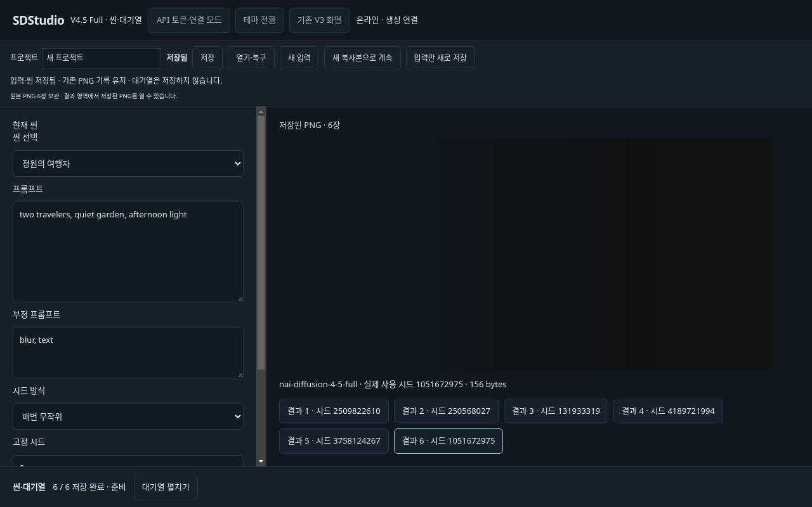
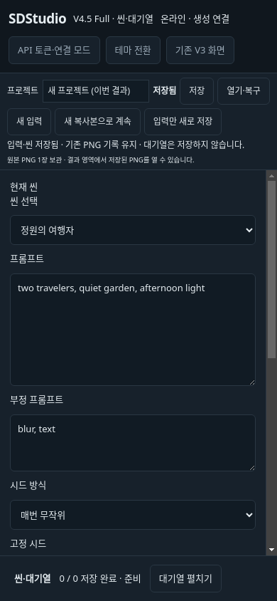

# 선택 씬·반복 기본 생성 큐 검증

작성일: 2026-11-23 (Asia/Seoul). 기준 main `ea7a979a4178f1f7a5d2b1afaa68f27d645304df`. 런타임 커밋 `6c1beb5f59fa2429ad5661398f73c46ce423c490`, 보완 `9e717e4eabd5c101dca9151d0f69a73491a38bb9`, 최종 tree `e4328f97aea43f728a4437778f4428ba56ce428f`. [정제 JSON](2026-11-23-connected-queue.json), [D-043](../DECISIONS.md), [사용·제약](../WORKSPACE_QUEUE.md), [PR22 처리](../reviews/2026-11-23-pr22-followup.md).

## 단위·타입·빌드

- 단위172/172·실패0·건너뜀0. 신규 큐17 + 기존 generation16/projectReads8/store13/controller8/service-close10/main36/response19/offline11/workspace14/contract10/network-mode10.
- 예약0전송·씬/반복·시드/요청 hash snapshot·랜덤 충돌 회피·고정0, 선택 부분 집합·미선택 V5 보존, 잘못된 예약/상한/5분 만료·확인 후 리비전 변경 거부를 검사했다.
- 메타데이터 읽기 중/공통 execute 최종 preflight 중 중지→전송0·pending 복귀, 전송 중 취소→해당 요청 실패·남은 pending만 새 확인,429에서 정지·자동 재시도 없음, 유효 PNG 저장 중 취소→저장 후 다음 요청 중단을 검사했다.
- 저장 실패/모호한 쓰기 뒤 선택 PNG 검증·메모리 pending 보존·저장-only 복구, 생성 중 외부 입력 변경 보존/다음 전송 중지, 최신 리비전 읽기~append 사이 충돌, 새 프로젝트 보관의 이전 잠금 유지·예약 종료를 확인했다.
- 마지막 새 프로젝트 보관 후처리 보완은 관련41건(queue17/generation16/projectReads8)을 다시 실행해41/41 통과했다. 전체172건을 이 후처리 수정 뒤 다시 전부 실행했다고 기록하지 않는다.
- 변경 TS/TSX7개 린트·scoped strict tsc·CJS 포맷/문법 통과. main/worker/renderer production 빌드와 notices244레코드 수집 통과. 마지막 코드 수정 후 동일 빌드를 다시 만들었다.
- Linux x64·Node22.4.1·Electron26.6.10(Node18.16.1)·builder24.13.3. npm11.19.1의 Node22.4.1 미지원 경고가 있어 권장 설치 조합은 아니다. 기존 의존성을 재사용했고 npm ci/native rebuild는 하지 않았다. 전체 저장소의 기존 TS2688은 해결/통과 범위가 아니다.

## 실제 Electron·ASAR

| 실행 | 검증 | 결과 |
| --- | --- | --- |
| production queue UI3PID | queue/create·다음 PID reopen·offline,8체크 | 통과 |
| 기존 단일 생성 UI3PID | create·reopen·offline,8체크. 공통 저장 후처리 수정 후 재실행 | 통과 |
| 실제 Linux directory ASAR | generation-queue6체크·app.isPackaged=true·프로필 격리·ASAR 불변 | 통과 |
| 실제 패키지 고지 |250 사본 hash·번들143발생·런타임112metadata 대응 | 통과, 기존8건 미해결 유지 |

새 큐 GUI는 준비/미확인 단계 요청0,3씬×2회 저장, 다음 묶음 첫 요청 취소 뒤 미전송5건만 새로 확인/실행, 결과 저장 실패 뒤 새 프로젝트 보관을 거친다. 해당 create PID의13건은 **루프백 HTTP 횟수**다(6완료+1취소+5완료+1결과-only 복구). 실제 계정 호출0이며 마지막 저장 복구 때문에14번째 네트워크 요청은 나가지 않았다. 이후 다른 PID에서 이번 결과 프로젝트를 열고, 오프라인에서도 원본 PNG 표시·실제 생성 거부를 확인했다.

ASAR의 dist/main/projectWorker.js는 unpacked=false다. archive SHA-256/실행 전후 불변과 packageContext는 JSON에 남겼다. 테스트 하네스는 loopback inspector로만 주입하고 제품 app.asar를 수정하지 않았다. singleton 잠금과390px 최소폭은 테스트 대체다. 전송 목적지는 하네스에서만 loopback으로 바꾸며 원격 요청/renderer 오류는 모든 보고서에서0이다. 임시 TOKEN.txt 부재에 대한 기존 read-file 로그는 실사용 자격증명을 읽었다는 뜻이 아니다.

마지막 보완에서 새 프로젝트 보관 뒤 이전 큐 항목에 그 새 image UUID가 남지 않도록 예약을 종료했다. 이 후처리를 최종 앱/ASAR로 다시 실행했고, 중지된 상태 snapshot을 폴링으로 과거 리비전에 되돌리지 않도록 했다. 늦은 폴링 응답은 renderer의 현재 리비전 비교로 무효화한다.

## 화면

2×1 합성 PNG(알파/메타데이터 검증 fixture)를 사용해 미리보기는 어두운 블록처럼 보인다. 실제 생성 그림·품질 검증 이미지가 아니다. 데스크톱은1280×800의6건 완료/접힌 큐, 좁은 폭은390×844의 새 결과 프로젝트/접힌 요약이다. 결과/입력은 본문 스크롤로 접근하며 가로 넘침은 없다. 기본/완료 때 한 줄 요약으로 접고 사용자가 펼친 완료 큐는 다음 폴링마다 강제로 접지 않는다.

## 한계

실제 계정으로 새 UI의1장/반복 생성, 정확한 NovelAI MIME, 실제 OS 키링·Windows/macOS,256 MiB 지연·worker 복사 비용은 측정하지 않았다. 이번에 캐릭터/다른 해상도/V5·프롬프트 조각 전개·영속 큐를 구현했다고 주장하지 않는다. 중지된 미전송 예약은 메모리에만 있고 main의 close/restart를 막지 않는다. 실제 실행·미저장 PNG는 기존 main hasWork로 계속 막는다. 원본 V3·mock 큐·PNG/프로젝트 버전·토큰/오프라인 경계는 유지한다.
